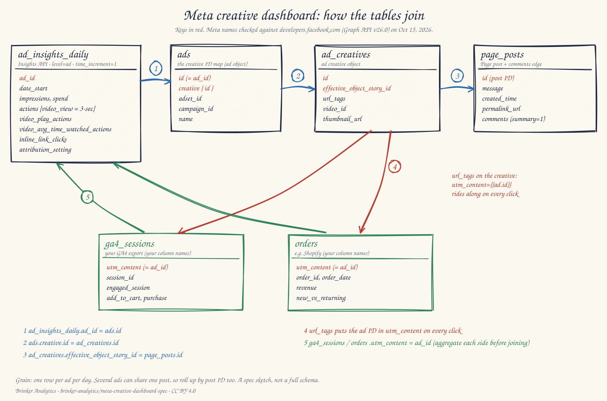

# meta-creative-dashboard-spec

A spec your AI assistant can follow to build a Meta creative dashboard in your own warehouse: tables, joins, metrics, and SQL.

> **Built by [Brinker Analytics](https://brinkeranalytics.com).** Eric Brinker's marketing-measurement consulting practice for DTC brands: geo tests, an MMM, and attribution.
> **Contact:** [eric@brinkeranalytics.com](mailto:eric@brinkeranalytics.com) or the [contact form](https://brinkeranalytics.com/marketing-analytics-consultant#qualification).

> **Full guide:** [How to Build a Meta Creative Analytics Dashboard That Reaches the Order](https://brinkeranalytics.com/insights/meta-creative-analytics-dashboard) on brinkeranalytics.com. It explains the reasoning behind each step.



*How the tables join. Meta field names were checked against Meta's developer reference (Graph API v26.0) on Oct 15, 2026. GA4 and order columns use your own warehouse names.*

## What it is, and what it isn't

**It is a roadmap.** Plain-language steps, field lists, join keys, metric formulas, and example SQL. You hand it to an AI coding assistant, along with access to your own warehouse, and it builds the tables step by step.

**It isn't software.** There's no connector, no ETL, no hosted dashboard, and no API keys. It assumes your Meta, GA4, and order data are already landing in a warehouse (BigQuery or otherwise).

It answers two questions:

1. Which creative ideas earn attention? (Seconds viewed per impression, thumbstop rate, hook rate.)
2. Which ones reach orders in my own data? (First-party orders per 1,000 impressions, set beside Meta's credit.)

It shows patterns, not proof. To learn whether a creative caused sales, test it. See the [creative performance analytics guide](https://brinkeranalytics.com/insights/creative-performance-analytics#test).

## Who it's for

- **For:** a DTC analyst or growth lead with Meta Marketing API access, an ETL landing Meta data in a warehouse, a GA4 export, and an order table (Shopify or similar).
- **Not for (yet):** teams with no warehouse. Start with the data foundation first.

## The spine

1. Pull ad-level daily insights: `/{ad-id}/insights` or an account-level call with `level=ad`, `time_increment=1`.
2. Join ad → creative (`creative{id}`) → Page post (`effective_object_story_id` = post `id`).
3. Put `utm_content={{ad.id}}` in every ad's URL parameters (the creative's `url_tags`).
4. Join GA4 sessions and orders back on that ad ID.
5. Set Meta's credit beside first-party orders. The gap is the finding.

## How to use it with an AI assistant

1. Clone the repo, or give your assistant the GitHub URL.
2. Tell it to read `AGENTS.md` first, then `docs/step-plan.md`.
3. Give it read access to your warehouse. Name your datasets and tables.
4. Have it work one step at a time. It checks every field against a live API sample and Meta's current docs, and stops to ask when something's missing.
5. Review each output table before the next step.

## Repository layout

```
README.md, AGENTS.md          start here
docs/step-plan.md             the 8 steps, in order
docs/entities.md              tables, grain, Mermaid diagram
docs/join-keys.md             every join: key, cardinality, failure modes
docs/fields/                  Meta Insights, creative + post, GA4 + orders
docs/url-tags.md              the {{ad.id}} template and the tag audit
docs/metrics.md               formulas (incl. seconds viewed per impression)
docs/compare-and-why.md       standard vs custom metrics, what each is for
docs/caveats.md               what the numbers can't tell you
sql/01-05_*.sql               example SQL (ANSI-ish, warehouse-neutral)
schemas/*.yml                 expected columns for each table
examples/synthetic/*.csv      tiny synthetic sample (no real brand data)
diagrams/                     the join diagram (SVG, PNG, and the rough.js script)
ROADMAP.md                    what's next
```

## About the field names

Every Meta field, parameter, and endpoint in `docs/fields/` was checked against Meta's developer reference (Graph API v26.0) on Oct 15, 2026. Anything that couldn't be verified is marked **[CHECK]**. Meta changes its API every version, so your assistant must re-check against the version you call and a live sample response.

## About the numbers

- **The sample data is synthetic.** `examples/synthetic/` has a handful of made-up ads, posts, sessions, and orders. It says nothing about real performance.
- **The metrics aren't guarantees.** Thumbstop, hook rate, CTA strength, and seconds per impression are ways to read creative. Test whether, and how, they move with your own results.

## License

- **Code** (SQL, schemas, scripts) and sample data: [MIT](LICENSE).
- **Documentation:** [CC BY 4.0](LICENSE-docs). Please attribute "Eric Brinker, Brinker Analytics" and link to the guide.
- **Citing:** see [CITATION.cff](CITATION.cff).

Written and maintained by Eric Brinker, [Brinker Analytics](https://brinkeranalytics.com). Not affiliated with or endorsed by Meta.
