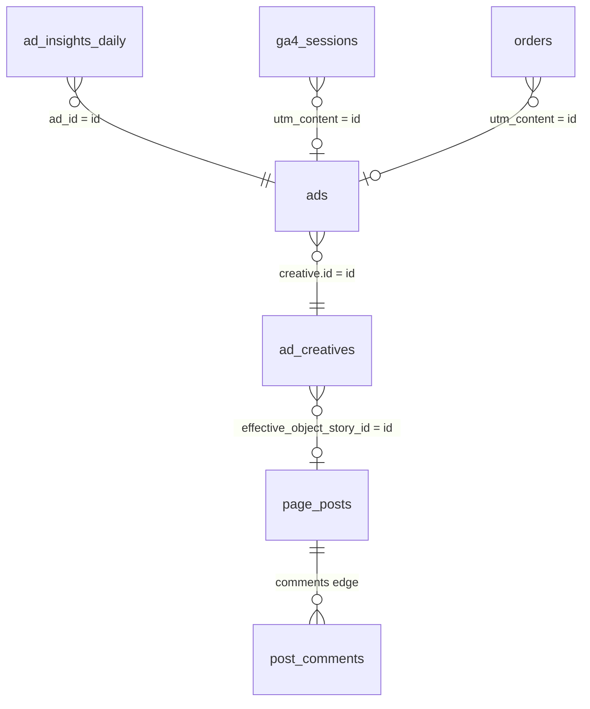

# Entities

| Table | Source | Grain | Primary key |
|---|---|---|---|
| `ad_insights_daily` | Insights API, `level=ad`, `time_increment=1` | ad × day (× attribution setting) | `ad_id`, `date_start` |
| `ads` | Ad object (`id`, `name`, `creative`, `adset_id`, `campaign_id`, `effective_status`) | ad × snapshot date | `ad_id`, `snapshot_date` |
| `ad_creatives` | Ad creative object | creative | `creative_id` |
| `page_posts` | Page post (`id`, `message`, `created_time`, `permalink_url`, `full_picture`) | post | `post_id` |
| `post_comments` | Post `comments` edge | comment (scrubbed text) or post-level count | `post_id` (+ row number) |
| `ga4_sessions` | GA4 export | session | `session_id` |
| `orders` | Order system (e.g. Shopify) | order | `order_id` |

Snapshot `ads` daily. A creative's `url_tags` can't be edited in place, so a tag fix means a new creative, and the ad-to-creative history matters.
